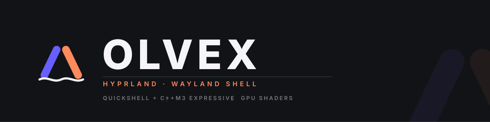

<div align="center">

  

  <br />

  <p align="center">
    <a href="#about"></a>
    <a href="#installation"></a>
    <a href="#keybindings"></a>
  </p>

  <h3>A Linux desktop environment shell built on Quickshell and Hyprland.</h3>

</div>

---

## Overview

**Olvex** is a desktop environment shell engineered for Linux systems running the **Hyprland** Wayland compositor. Built using **Quickshell** (a Qt6 QML framework) and native C++ plugins, Olvex implements Google's Material Design 3 (M3 Expressive) design system, complete with dynamic theme extraction, hardware-accelerated rendering, and modular multi-monitor window management.

### Key Architectural Capabilities

- **Dynamic Theme Extraction**: Dynamically parses wallpaper color palettes to generate Material Design 3 color tokens (`scheme.json`).
- **Hardware Acceleration**: C++ plugin extensions for real-time PipeWire audio spectral analysis via Cava and beat tracking via Aubio.
- **Shader Pipeline**: Low-latency GPU layer-shell rendering for glassmorphic blurs, shape morphs, and spring physics.
- **Multi-Monitor Orchestration**: Per-screen drawer management with isolated monitor configuration targets (`~/.config/olvex/monitors/`).
- **XDG Terminal Integration**: Native Fish and Bash prompt integrations with subpixel Braille branding aligned to active system accents.

---

## Desktop Components

Olvex includes a comprehensive suite of shell interfaces:

| Component | Description |
| :--- | :--- |
| **Status Bar** | Top and bottom panel surfaces hosting workspace selectors, status indicators, and active window metadata. |
| **Dashboard** | Central overlay containing hardware performance graphs, media controls, weather reports, and quick toggles. |
| **Application Launcher** | Rapid application dispatcher featuring inline mathematical calculations and wallpaper selection. |
| **Control Center** | Independent Qt window providing fine-grained desktop environment preferences and system controls. |
| **Clipboard Manager** | Dedicated floating interface (`olvex-clipboard`) backed by `cliphist` for text and image history. |
| **Emoji Picker** | Standalone picker (`olvex-emoji`) with search, category tabs, and glyph metrics. |
| **Notification Daemon** | Desktop notification service implementing Material Design 3 toast alerts and persistent history. |
| **Screen Locker** | Security lock surface with frosted card/clock morphs, authentication feedback, Bento widgets, and procedural cat simulation. |
| **Setup Wizard & Cheatsheet** | First-run onboarding wizard (`olvex shell setup`) and live Hyprland shortcuts cheatsheet (`Super + /`). |

---

## Prerequisites & Dependencies

### Package Requirements (Arch Linux / CachyOS)

Ensure the following packages are installed before compiling and launching Olvex:

#### 1. Core Build & Qt6 Framework
- `base-devel`, `cmake`, `ninja`, `git`, `pkgconf`, `gcc-libs`, `glibc`
- `qt6-base`, `qt6-declarative`, `qt6-shadertools`, `qt6-wayland`, `qt6-5compat`, `qt6-multimedia`, `qt6-svg`, `qt6-imageformats`

#### 2. Compositor, Shell & Wallpaper Engine
- `hyprland` (Wayland Compositor)
- `quickshell` (Extra) (Qt6 QML Desktop Shell Framework)
- `swww` (Wallpaper Daemon)
- `matugen` (Material Design 3 Dynamic Color Generator)
- `m3shapes` (C++ Shape Mask Library)

#### 3. Audio, Display & Hardware Services
- `pipewire`, `libpipewire`, `wireplumber`
- `cava`, `libcava`, `aubio` (Audio Spectral Analysis & Beat Tracking)
- `brightnessctl`, `ddcutil` (Backlight & Monitor DDC Controls)
- `lm-sensors`, `upower` (Hardware Temperature & Battery)
- `networkmanager`, `bluez`, `bluez-utils` (Network & Bluetooth)
- `fprintd` (Fingerprint PAM Integration)

#### 4. File Management, Authentication & Browser
- `thunar`, `thunar-volman`, `thunar-archive-plugin`, `thunar-media-tags-plugin` (File Manager & Extensions)
- `tumbler`, `ffmpegthumbnailer` (Thumbnail Generators)
- `gvfs`, `gvfs-mtp`, `gvfs-gphoto2`, `gvfs-afc`, `gvfs-smb` (Virtual File System & Mounting)
- `polkit-gnome` (Authentication Agent)
- `firefox` (Web Browser)

#### 5. Desktop Utilities, Capture & Terminal
- `cliphist`, `wl-clipboard` (Clipboard History & Selection)
- `grim`, `slurp`, `swappy` (Interactive Screenshot & Annotation)
- `gpu-screen-recorder` (Hardware-Accelerated Screen Recorder)
- `ydotool` (Virtual Input Controls & Gestures)
- `libqalculate` (Launcher Calculator Backend)
- `libnotify` (Desktop Notification Protocol)
- `mpv` (Media Engine)
- `app2unit` (Systemd Application Unit Manager)
- `foot` (Terminal Emulator)
- `bash`, `fish`, `xdg-utils`

#### 6. Fonts & Icon Typography
- `ttf-material-symbols` / `material-symbols`
- `caskaydia-cove-nerd`
- `ttf-rubik`

#### 7. Python Runtime & Image Libraries
- `python3`, `python-pip`, `python-pillow`

---

## Installation Guide

### Option A: Automated Setup

Clone the repository and run the setup script:

```bash
git clone https://github.com/MHMNR/Olvex.git
cd Olvex
./setup.sh
```

### Updating Olvex

To update an existing Olvex installation to the latest release while preserving your installer choices, run:

```bash
olvex update
```

To check whether upstream updates are available without applying them:

```bash
olvex update --check
```

---

### Option B: Full Manual Installation (Step-by-Step)

If you prefer building and installing all components manually, follow these detailed steps:

#### Step 1: Install Package Dependencies

**Arch Linux / CachyOS Repository Packages:**
```bash
sudo pacman -S --needed \
    base-devel cmake ninja git pkgconf gcc-libs glibc \
    qt6-base qt6-declarative qt6-shadertools qt6-wayland qt6-5compat qt6-multimedia qt6-svg qt6-imageformats \
    hyprland swww pipewire libpipewire wireplumber cava aubio \
    brightnessctl ddcutil lm-sensors upower networkmanager bluez bluez-utils fprintd \
    thunar thunar-volman thunar-archive-plugin thunar-media-tags-plugin adw-gtk-theme xdg-desktop-portal-gtk tumbler ffmpegthumbnailer \
    gvfs gvfs-mtp gvfs-gphoto2 gvfs-afc gvfs-smb polkit-gnome firefox \
    cliphist wl-clipboard grim slurp swappy gpu-screen-recorder ydotool \
    libqalculate libnotify mpv foot bash fish xdg-utils \
    ttf-rubik python3 python-pip python-pillow
```

**AUR Packages (via `yay` or `paru`):**
```bash
yay -S --needed \
    quickshell matugen m3shapes app2unit \
    material-symbols caskaydia-cove-nerd
```

---

#### Step 2: Clone the Repository
```bash
git clone https://github.com/MHMNR/Olvex.git
cd Olvex
```

---

#### Step 3: Build & Install C++ Plugins

Olvex relies on custom native C++ QML plugins (`Olvex`, `Olvex.Config`, `Olvex.Services`, `Olvex.Internal`, etc.) located in `plugin/`:

```bash
# Create build directory
mkdir -p build && cd build

# Configure CMake project with Ninja generator
cmake -G Ninja -DCMAKE_BUILD_TYPE=Release ..

# Build C++ modules
ninja

# Install plugin to Qt QML import path
sudo cmake --install .
cd ..
```

---

#### Step 4: Deploy Shell Files & Executable Scripts

Copy the QML shell code to Quickshell's configuration path and install the `olvex` CLI helper:

```bash
# Create configuration directories
mkdir -p ~/.config/quickshell/olvex
mkdir -p ~/.config/olvex
mkdir -p ~/.local/bin

# Copy QML shell files
cp -r Olvex/* ~/.config/quickshell/olvex/

# Install olvex CLI executable
cp scripts/olvex ~/.local/bin/
chmod +x ~/.local/bin/olvex

# Ensure ~/.local/bin is in your PATH
export PATH="$HOME/.local/bin:$PATH"
```

---

#### Step 5: Setup Virtual Input (`ydotool`)

Olvex uses `ydotool` for virtual keypresses and gesture controls:

```bash
# Enable and start ydotool daemon
sudo systemctl enable --now ydotool

# Add current user to input group for permissions
sudo usermod -aG input $USER
```

---

#### Step 6: Configure Hyprland Autostart

Add the following execution lines to your Hyprland configuration file (`~/.config/hypr/hyprland.conf` or `~/.config/hypr/hyprland/execs.conf`):

```ini
# Start ydotool daemon
exec-once = ydotool daemon

# Launch Olvex Shell via Quickshell (standard deployed path)
exec-once = quickshell -p ~/.config/quickshell/olvex/

# Or launch directly from your custom clone/development directory:
# exec-once = quickshell -p /PATH_TO_YOUR_DIR/Olvex/
```

---

#### Step 7: Launch Olvex Shell

Start the shell manually for testing or live development:

```bash
# Standard deployed configuration path:
quickshell -p ~/.config/quickshell/olvex/

# Or launch directly from custom development directory:
quickshell -p /PATH_TO_YOUR_DIR/Olvex/
```

Or run via the CLI dispatcher:
```bash
olvex shell -d
```

---

## Default Keybindings (Hyprland)

Keybindings are configured in Lua within `~/.config/hypr/variables.lua` and `~/.config/hypr/hyprland/keybinds.lua`. You can also press `Super + /` anytime to open the interactive **Shortcuts Cheatsheet**.

### Shell, Lockscreen & Session
| Keybinding | Action |
| :--- | :--- |
| `Super` *(tap release)* | Toggle Application Launcher |
| `Super + N` | Toggle Notification Sidebar |
| `Super + K` | Toggle All Panels *(Launcher, Dashboard & QS Panel)* |
| `Super + W` | Open Wallpaper Selector |
| `Super + /` / `Super + ?` | Toggle Keyboard Shortcuts Cheatsheet |
| `Ctrl + Alt + C` | Clear All Notifications |
| `Super + L` | Lock Session |
| `Super + Alt + L` | Restore Shell *(if stopped)* & Lock Session |
| `Super + Shift + L` | Sleep (`systemctl suspend-then-hibernate`) |
| `Ctrl + Alt + Delete` | Toggle Power / Session Menu |
| `Ctrl + Super + Shift + R` | Terminate Shell Process |
| `Ctrl + Super + Alt + R` | Restart Shell Daemon |

### Applications
| Keybinding | Action |
| :--- | :--- |
| `Super + T` | Open Terminal (`kitty`) |
| `Super + B` | Open Browser (`firefox`) |
| `Super + C` | Open Code Editor (`antigravity`) |
| `Super + E` | Open File Manager (`thunar`) |
| `Super + Alt + E` | Open Secondary File Manager (`nemo`) |
| `Super + G` | Open GitHub Desktop |
| `Ctrl + Alt + Escape` | Open Process Manager (`qps`) |
| `Ctrl + Alt + V` | Open Audio Controls (`pavucontrol`) |
| `Super + J` | Open Text Editor (`xed`) |

### Clipboard, Emoji, Screenshot & Recording
| Keybinding | Action |
| :--- | :--- |
| `Super + V` | Toggle Clipboard Manager |
| `Super + Alt + V` | Delete Clipboard Entry |
| `Ctrl + Shift + Alt + V` | Paste Latest Clipboard Entry (`ydotool`) |
| `Super + .` *(Period)* | Toggle Emoji Picker |
| `Print` | Capture Fullscreen Screenshot |
| `Super + Shift + S` | Interactive Screenshot / Freeze Selector |
| `Super + Shift + Alt + S` | Capture Region *(Interactive)* |
| `Ctrl + Alt + R` | Toggle Screen Recording |
| `Super + Alt + R` | Toggle Screen Recording *(with Audio)* |
| `Super + Shift + Alt + R` | Toggle Region Screen Recording |
| `Super + Shift + C` | Pick Color to Clipboard (`hyprpicker`) |

### Media, Volume & Brightness
| Keybinding | Action |
| :--- | :--- |
| `Ctrl + Super + Space` / `XF86AudioPlay` / `XF86AudioPause` | Play / Pause Media |
| `Ctrl + Super + =` / `XF86AudioNext` | Next Track |
| `Ctrl + Super + -` / `XF86AudioPrev` | Previous Track |
| `Ctrl + Super + Backspace` / `XF86AudioStop` | Stop Media |
| `Super + Shift + M` / `XF86AudioMute` | Toggle Output Mute |
| `XF86AudioMicMute` | Toggle Microphone Mute |
| `XF86AudioRaiseVolume` / `XF86AudioLowerVolume` | Raise / Lower Volume |
| `XF86MonBrightnessUp` / `XF86MonBrightnessDown` | Raise / Lower Screen Brightness |

### Workspaces, Windows & Groups
| Keybinding | Action |
| :--- | :--- |
| `Super + 0-9` / `Ctrl + Super + 0-9` | Switch to Workspace / Workspace Group *(1–10)* |
| `Super + Shift + 0-9` / `Ctrl + Super + Alt + 0-9` | Move Window to Workspace / Workspace Group |
| `Super + Scroll` / `Super + PageUp/Down` / `Ctrl + Super + Left/Right` | Switch to Next / Previous Workspace |
| `Ctrl + Super + Scroll` | Switch to Next / Previous Workspace Group |
| `Super + Alt + Scroll` / `Super + Alt + PageUp/Down` / `Ctrl + Super + Shift + Left/Right` | Move Window to Next / Previous Workspace |
| `Super + Alt + S` / `Ctrl + Super + Shift + Up` | Move Window to Special Workspace |
| `Ctrl + Super + Shift + Down` | Move Window out of Special Workspace |
| `Super + S` | Toggle Special Workspace (`special:special`) |
| `Ctrl + Shift + Escape` | Toggle System Monitor Workspace (`special:sysmon`) |
| `Super + M` | Toggle Music Workspace (`special:music`) |
| `Super + D` | Toggle Communication Workspace (`special:communication`) |
| `Super + R` | Toggle Todo Workspace (`special:todo`) |
| `Super + Arrow` / `Super + Shift + Arrow` | Focus / Move Window in Direction |
| `Super + -` / `Super + =` / `Super + Alt + Arrow` | Resize Window Width / Height |
| `Super + Z` / `Super + Left-Drag` | Move Window |
| `Super + X` / `Super + Right-Drag` | Resize Window |
| `Ctrl + Super + \` | Center Floating Window |
| `Ctrl + Super + Alt + \` | Normalize & Center Floating Window |
| `Super + Alt + \` | Toggle Floating PiP Window |
| `Super + P` | Pin Floating Window |
| `Super + F` / `Super + Alt + F` | Fullscreen / Maximized Window |
| `Super + Alt + Space` | Toggle Floating Window |
| `Super + Q` | Close Active Window |
| `Super + ,` / `Super + U` / `Super + Shift + ,` | Toggle Group / Ungroup / Lock Group |
| `Alt + Tab` / `Shift + Alt + Tab` | Cycle Windows |
| `Ctrl + Alt + Tab` / `Ctrl + Shift + Alt + Tab` | Cycle Windows in Group |

---

## IPC Command Interface

Olvex exposes Quickshell `IpcHandler` targets via `olvex shell <target> <method> [args...]` (or `qs ipc call <target> <method> [args...]`).

### Drawers, Windows & Onboarding
```bash
olvex shell drawers list                               # List available drawer names
olvex shell drawers toggle <drawer>                    # Toggle drawer (bar, launcher, dashboard, qspanel, powermenu/session, secondaryPanel, notificationcenter, wallpaperLauncher, osk, help, cheatsheet)
olvex toggle <drawer>                                  # Shorthand for drawers toggle
olvex shell drawers openWallpapers                     # Open launcher in wallpaper switcher mode
olvex shell settings open [page] [section]             # Open Control Center (optionally to a page/section)
olvex shell setup open|close|toggle                    # Control Setup Wizard window
olvex shell help open|close|toggle                     # Control Shortcuts Cheatsheet window
olvex shell cheatsheet open|close|toggle               # Alias for help target
```

### Lockscreen, Notifications & Toasts
```bash
olvex shell lock lock                                  # Engage lock screen
olvex shell lock unlock                                # Unlock session
olvex shell lock isLocked                              # Query lock state (bool)
olvex shell notifs clear                               # Clear all notifications
olvex shell notifs isDndEnabled                        # Check Do Not Disturb state
olvex shell notifs toggleDnd|enableDnd|disableDnd      # Control Do Not Disturb mode
olvex shell toaster info|success|warn|error "<title>" "<message>" "[icon]"  # Trigger toast
```

### Display, Brightness, Night Light & Modes
```bash
olvex shell brightness get                             # Get active monitor brightness
olvex shell brightness getFor <query>                  # Get brightness by active/model/serial/id/name
olvex shell brightness set <value>                     # Set active brightness (0.5, +0.1, 0.1-, 50%, +10%, 10%-)
olvex shell brightness setFor <query> <value>          # Set brightness for matching monitor
olvex shell nightlight isEnabled|toggle                # Query or toggle Night Light
olvex shell nightlight setEnabled <true|false>         # Enable or disable Night Light
olvex shell nightlight setTemperature <kelvin>         # Set Night Light color temperature
olvex shell nightlight setAutoSchedule <true|false>    # Toggle automatic Night Light schedule
olvex shell gameMode isEnabled|toggle|enable|disable   # Query or control Game Mode
olvex shell idleInhibitor isEnabled|toggle|enable|disable  # Query or control Idle Inhibitor
```

### Media, Audio, Wallpaper, Icons & Weather
```bash
olvex shell mpris list                                 # List active MPRIS players
olvex shell mpris getActive <prop>                     # Read active player property (e.g. trackTitle, trackArtist)
olvex shell mpris play|pause|playPause|next|previous|stop  # Control active MPRIS player
olvex shell audio cycleOutput                          # Cycle audio output sink
olvex shell wallpaper get|list                         # Get active wallpaper or list catalog paths
olvex shell wallpaper set <path>                       # Set wallpaper by file path
olvex shell icons get                                  # Get current icon theme
olvex shell icons reload [theme]                       # Reload or apply icon theme
olvex shell weather toggleDemo|nextDemo                # Toggle or cycle weather demo presets
olvex shell weather setDemo <index>                    # Activate specific weather demo preset
```

### Capture, Windows, Hyprland & Hardware
```bash
olvex shell picker open|openFreeze|openClip|openFreezeClip  # Open area screenshot/region picker
olvex shell resizer pip                                # Toggle PiP mode for active window (alias: olvex resizer pip)
olvex shell resizer pipWindow <address>                # Toggle PiP mode for specific window address
olvex shell hypr refreshDevices                        # Refresh Hyprland input devices
olvex shell hypr cycleSpecialWorkspace <direction>     # Cycle active special workspace
olvex shell hypr listSpecialWorkspaces                 # List non-empty special workspaces
olvex shell charging ripple                            # Trigger charging ripple shader effect
olvex shell hardwareButtons lidClose|lidOpen|powerBtn  # Trigger configured hardware button action
```

### Process, Inspection & CLI Commands
```bash
olvex shell [-d]                                       # Start shell (or daemonize with -d)
olvex shell restart                                    # Restart running shell daemon
olvex shell kill                                       # Terminate shell process
olvex shell show                                       # Print all live IPC targets and signatures (alias: ipc-show)
olvex shell log                                        # View shell logs
olvex restart                                          # Top-level restart alias
olvex update [--check|-c] [--force|-f]                 # Check or install upstream updates
olvex wallpaper [args...]                              # Manage wallpapers (or open selector if no args)
olvex scheme <list|get|set> ...                        # Manage active M3 color scheme
olvex screenshot [-r] [-f]                             # Capture screen / region / freeze
olvex record [-s] [-r]                                 # Screen recording (sound / region)
olvex clipboard [-d]                                   # Open or delete from clipboard history
olvex emoji [-p]                                       # Toggle emoji picker
```

---

## Configuration Paths

- **QML Shell Target**: `~/.config/quickshell/olvex/`
- **Global Configuration**: `~/.config/olvex/shell.json`
- **Theme & CLI State**: `~/.config/olvex/theme.json`, `~/.config/olvex/cli.json`
- **Per-Monitor Overrides**: `~/.config/olvex/monitors/<MONITOR_NAME>/shell.json`
- **System Accent Tokens**: `~/.local/state/olvex/scheme.json`
- **Hyprland Keybinds**: `~/.config/hypr/variables.lua`, `~/.config/hypr/hyprland/keybinds.lua`

---

## Credits

Olvex began as a fork of [**Caelestia**](https://github.com/caelestia-dots/shell) and has since been substantially redesigned — the majority of the UI, component architecture, and the native C++ plugin layer are original to this project. That said, none of this exists in a vacuum, and it would be dishonest not to name the work this project stands on.

### Special thanks

- **[Caelestia](https://github.com/caelestia-dots/shell)** ([@caelestia-dots](https://github.com/caelestia-dots)) — the original base this shell was forked from, and the project that first showed what a fluid, morphing Quickshell environment for Hyprland could look like. Large parts of Olvex's architecture trace their lineage back here, even where the implementation has since diverged completely.
- **[Dank Material Shell](https://github.com/AvengeMedia/DankMaterialShell)** ([@AvengeMedia](https://github.com/AvengeMedia)) — several UI ideas and interaction patterns in Olvex were inspired by DMS's take on Material theming for Quickshell.
- **[illogical-impulse](https://github.com/end-4/dots-hyprland)** ([@end-4](https://github.com/end-4)) — an early and ongoing influence on the Hyprland + Quickshell rice scene, and the source of a few conventions adapted into Olvex.
- **[Quickshell](https://github.com/quickshell-mirror/quickshell)** ([@outfoxxed](https://github.com/outfoxxed)) — for building and maintaining the framework all of this runs on.
- **[Hyprland](https://github.com/hyprwm/Hyprland)** ([@vaxry](https://github.com/vaxry) and contributors) — the compositor Olvex is built for.

If you recognize a component, animation, or pattern from your own project and think it deserves a more specific mention here, please open an issue — attribution gaps are bugs, not decisions.

---
